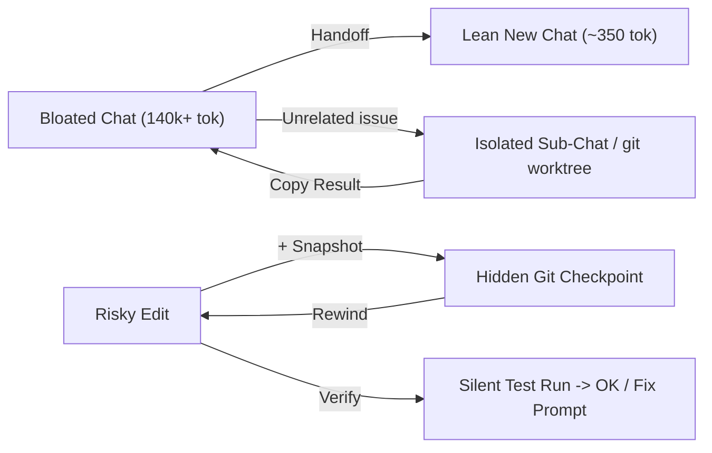

# ctxpilot (`ctx`)

> **Stop burning 50% of your context window on unused MCP schemas. Zero-dependency context analyzer, multi-client secret doctor, git checkpoints/rewind, silent verify, and Claude Code workflows inside Antigravity.**

`ctxpilot` (`ctx`) v0.5.0 runs in two modes:
1. **Safe Mode (CLI-only, zero file patching)**: Works standalone across **Antigravity, Claude Code, Cursor, and Windsurf** (`npx ctxpilot doctor`, `context`, `checkpoint`, `rewind`, `verify`, `handoff`).
2. **Overview Hub Mode (optional, `ctx patch install`)**: Injects the `CTXPILOT` control center directly into Antigravity's Overview sidebar and inline chat actions — with automatic `app.asar.bak` backup, SHA-256 integrity verification, and instant `ctx patch restore`.

---

## Why `ctxpilot`?

- **Multi-Client MCP & Secret Hygiene (`ctx doctor --fix`)**: Audits MCP configs across **Antigravity** (`~/.gemini/config/mcp_config.json`), **Claude Code** (`~/.claude.json`, `.mcp.json`), **Cursor** (`~/.cursor/mcp.json`), and **Windsurf**. Masks plaintext tokens with prefix-free labels (`[REDACTED: bearer-token]`) and migrates secrets to OS Env + `~/.gemini/.env` as `${ENV_VAR}`.
- **Token Bloat & Cache-Health Telemetry (`ctx context`)**: Breaks down static overhead (Rules, MCP tool schemas, Skills metadata) plus live `transcript.jsonl` context usage, cumulative session burn, and cache-bust alerts.
- **1-Click MCP Park & DB `READONLY` Profiles (`ctx park` / `ctx profile`)**: Unloads unused MCP servers into `mcp_disabled.json` without deleting them, enforces `READONLY=true` on DB servers, and syncs `.agents/rules/00-active-mcps.md`.
- **Git Checkpoints & Safe Rewind (`ctx checkpoint` / `ctx rewind`)**: Hidden git tree snapshots (`refs/ctxpilot/checkpoints/*`) that capture tracked + untracked files without touching `HEAD`, `git log`, `git stash`, or `.env`.
- **Silent Background Verify (`ctx verify`)**: Auto-detects `npm test`, `dotnet test`, `pytest`, `cargo test`, or `go test ./...`, runs quietly in the background, and lets you send failures straight into chat.
- **Real `Handoff`, Isolated `Sub-Chat`, & Parallel `git worktree` (`ctx handoff` / `ctx subchat --worktree`)**: Compacts bloated chats into lean ~350-token New Chat handoffs, isolates unrelated side bugs into Sub-Chats (or separate `git worktree` directories), and carries results back to the parent chat.
- **Zero Telemetry**: Zero outbound network requests (unless you explicitly pass `--ping` to probe HTTP MCP endpoints).



---

## Quick Start

Run directly without installing (Node.js 18+):

```bash
npx ctxpilot doctor --fix-suggest
npx ctxpilot context
```

Or install globally (provides both `ctxpilot` and `ctx` commands):

```bash
npm install -g ctxpilot
ctx patch install --restart   # Optional: injects CTXPILOT hub & inline chat actions into Antigravity
```

---

## Commands

### `ctx doctor` — Multi-Client Audit & Secret Auto-Fix

Audits Antigravity, Claude Code, Cursor, and Windsurf MCP configs, database `READONLY` flags, stdio binaries, remote URLs, rule size caps (`24,000` bytes/file, `20,000` tokens `defaultRulesBudget`), `.agents/hooks.json`, and Overview Hub patch status.

```text
ctxpilot doctor (read-only)
Workspace: ~/projects/my-app
────────────────────────────────────────────────────────────────────
  [OK]   ~/.gemini/config/mcp_config.json        Valid JSON
  [OK]   context7                                http (mcp.context7.com)
  [FAIL] context7                                Plaintext [REDACTED: bearer-token] in headers.Authorization
  [FAIL] github (claude-code)                    Plaintext [REDACTED: github-pat] in headers.Authorization
  [OK]   mssql                                   READONLY=true (safe) | host=localhost
  [OK]   .agents/rules/                          15 file(s) | largest: 13.9 KB / 24.0 KB limit
  [OK]   Antigravity app.asar                    Overview Hub patched (v2.31.2)
────────────────────────────────────────────────────────────────────
Summary: 6 ok, 0 warning(s), 2 failure(s).
```

Flags: `--fix`, `--fix-suggest`, `--strict`, `--json`, `--ping`, `--workspace <dir>`, `--dry-run`.

### `ctx context` — Token Budget & Session Burn

Measures **Rules**, **Active MCP Tool Schemas**, **Skills metadata**, live context fill, cumulative session burn, and prompt-cache health (`<25%` cache hit warning).

### `ctx park` / `ctx unpark` / `ctx ro` / `ctx rw` / `ctx profile`

```bash
ctx profile list
ctx profile db-ro                 # keep DB servers in READONLY=true + serena
ctx park mssql                    # move to mcp_disabled.json
ctx unpark mssql                  # restore it
ctx ro mssql                      # enforce READONLY=true
```

### `ctx sync` — Cross-Agent Rule & MCP Sync

Keep **one canonical source** (`AGENTS.md` + `.agents/rules/*.md` + saved `FIXES`) and compile it cleanly into **Claude Code** (`CLAUDE.md`), **Codex** (`AGENTS.md`), **Cursor** (`.cursor/rules/ctxpilot-synced.mdc`), and **Windsurf** (`.windsurfrules`). Pass `--mcp` to mirror active MCPs with secrets sanitized to `${ENV_VAR}`:

```bash
ctx sync --dry-run
ctx sync --mcp
```

### `ctx gate` — Pre-Push Attribution & Secret Gate

Separates files edited by the active AI chat from your unrelated local edits, scans diffs and untracked files for leaked secrets / `.env`, runs `ctx doctor`, and runs `ctx verify`:

```bash
ctx gate --strict
```

### `ctx timeline` & `ctx fork <turn>` — Turn Replay & Fork

```bash
ctx timeline                      # per-turn token footprint & touched files
ctx fork 2                        # branch an isolated Sub-Chat from Turn 2
```

### `ctx checkpoint` & `ctx rewind` — Auto & Manual Snapshots

```bash
ctx checkpoint create before-refactor
ctx checkpoint list
ctx rewind                        # rewinds working tree to latest checkpoint without moving HEAD
ctx rewind --dry-run
```

### `ctx verify` — Silent Background Checks

```bash
ctx verify                        # auto-detects npm test / dotnet test / pytest / cargo test / go test
```

### `ctx handoff`, `ctx subchat`, `ctx worktree`, `ctx fix`

```bash
ctx handoff                       # build ~350-tok New Chat handoff from transcript + git status
ctx subchat "fix auth flake"      # build isolated sub-chat prompt
ctx subchat --worktree "refactor" # create sibling git worktree + branch ctxpilot/*
ctx worktree list
ctx fix add "syncCoreCache must copy patcher/"
```

### `ctx patch` — Optional Antigravity Overview Hub + Inline Chat Actions

Adds the `CTXPILOT` Overview panel (auto-detected workspace, MCP toggles, 1-click `Restart`, `Checkpoints`, `Fixes`, `Handoff`, `Sub-Chat`) and inline chat pills (`Proceed`, `Verify`, `Rewind`, `Commit & Push`, `Open Sub-Chat`, `Handoff`) next to `Review` / message feedback:

```bash
ctx patch install --dry-run
ctx patch install --restart
ctx patch ensure --restart        # re-applies cleanly after Antigravity updates
ctx patch status
ctx patch restore --restart       # restores original app.asar.bak anytime
```

### `ctx init` / `ctx hub init` / `ctx bench` / `ctx bundle`

- **`ctx init [nextjs|dotnet|node|python|auto]`**: Scaffolds lean `.agents/rules/01-stack-conventions.md` + `.agents/hub.json` (supports `"autoProfile": true` and `"verify": "..."`).
- **`ctx bench [--run-hooks]`**: Audits rule bloat/duplicates and benchmarks enabled hooks (`<500 ms` budget, `{}` stdin, 2s timeout).
- **`ctx bundle export | import`**: Exports `.agents/rules`, `hooks.json`, `hub.json`, and sanitized `${ENV_VAR}` MCP templates cleanly across teams.

---

## Roadmap

- **`v0.1`**: Read-only `doctor` + `context` + `SECURITY.md`
- **`v0.2`**: `ctx` alias, MCP profiles (`full`, `code-docs`, `db-ro`, `lean`), `park/unpark/ro/rw`
- **`v0.3`**: Direct Antigravity Overview Hub injection (`ctx patch`) with SHA-256 verification
- **`v0.4`**: Bloat cutter, `doctor --fix`, `patch ensure`, `init`, `bench`, `bundle`
- **`v0.5`** (current): Multi-client MCP (`Claude Code`, `Cursor`, `Windsurf`), `Handoff`, `Sub-Chat` & `git worktree` isolation, `Git Checkpoint / Rewind`, silent `Verify`, session burn + cache-health monitor, auto-workspace detection, 1-click Restart, and inline chat actions
- **`v1.0`**: npm publish & provenance, SBOM

## Security & Compatibility

- Threat model: [`SECURITY.md`](./SECURITY.md)
- Verified on Antigravity `2.31.2` (Windows 11, Node.js `v24.18.0`; CI tested across Linux, macOS, and Windows).
- Unofficial community project; not affiliated with Google.

## License

[MIT](./LICENSE)
